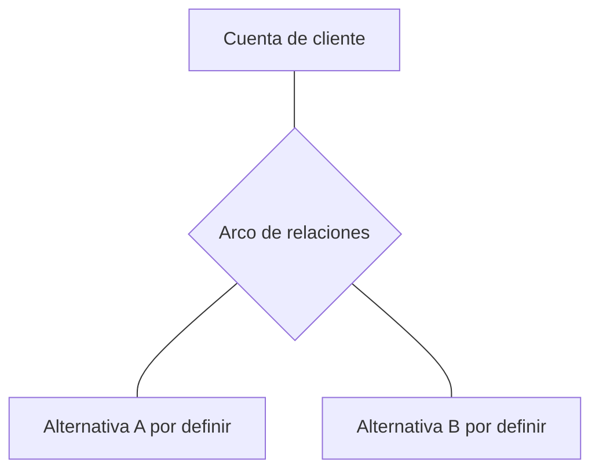

# Proyecto OBL - Ejercicio Completo

> [!summary] En una frase
> Diseña una base de datos para la tienda Oracle Baseball League (OBL), desde la revisión de su ERD inicial hasta un modelo físico para Oracle que puedas justificar con las reglas del negocio.

## Índice

- [[#Enunciado]]
- [[#1. Levantar las reglas y preparar el ERD]]
- [[#2. Refinar las relaciones del negocio]]
- [[#3. Conservar precios y revisar otros cambios]]
- [[#4. Normalizar los datos]]
- [[#5. Transformar el modelo lógico a Oracle]]
- [[#6. Completar el ERD final]]
- [[#7. Revisar el proyecto completo]]
- [[#Fuentes y conceptos relacionados]]

## Enunciado

OBL es una tienda de artículos de béisbol. Vende pelotas, guantes, zapatillas, ropa y equipamiento para equipos. Te contrata para revisar su diseño inicial y dejarlo listo para convertirlo en tablas de Oracle. Usa como punto de partida tu trabajo en [[Ejercicios Sección 2#Ejercicio 2.3 — Base de datos de la tienda Oracle Baseball League|el caso OBL de la Sección 2]] o la plantilla de esta nota. Conserva la misma versión de trabajo del modelo y actualízala al cerrar cada etapa.

El caso inicial también pide registrar el precio unitario de la compra y obtener el total del pedido. Conserva la capacidad de reconstruir esos importes al incorporar el historial de precios y revisar los campos derivados.

### Reglas del caso

| ID | Información de la tienda |
|---|---|
| OBL-01 | Una persona puede comprar por cuenta propia y representar a un equipo. En ese caso tiene dos cuentas separadas y las compras de ambas se gestionan por separado. OBL registra datos de contacto y saldo actual. |
| OBL-02 | Cada equipo tiene un único representante oficial. Una persona representa como máximo a un equipo a la vez. Solo la persona registrada puede hacer pedidos en nombre de su equipo. |
| OBL-03 | Cualquier cuenta puede comprar cualquier artículo del inventario. El pedido queda vinculado a la cuenta que lo hizo y su titularidad permanece fija. OBL registra los artículos y las cantidades pedidas y enviadas de cada uno. |
| OBL-04 | OBL cuenta con tres representantes de ventas. Cada representante de equipo tiene un único vendedor asignado. Uno de los vendedores supervisa y asigna equipos a los vendedores, incluido él mismo. Los vendedores trabajan a comisión. También pueden ayudar con problemas de pedidos de clientes individuales. |
| OBL-05 | Un cliente puede registrar varias direcciones de entrega y cada dirección registrada pertenece a un único cliente. Para el representante de ventas se conserva solo la dirección actual. |
| OBL-06 | El descuento de equipo se calcula sobre el precio de lista. Con menos de 9 jugadores es 0 %, de 9 a 24 es 5 %, de 25 a 40 es 10 % y con más de 40 es 20 %. |
| OBL-07 | La tarjeta de fidelización es opcional para clientes individuales. Da acceso a ventas nocturnas y OBL prescinde del detalle de las compras hechas en esos eventos. |
| OBL-08 | OBL conserva el historial del precio de lista de los artículos. El catálogo registra nombre, descripción, categoría, color y talla cuando corresponda. El inventario registra el costo unitario mayorista y las unidades disponibles, con cero cuando se agotan. |

> [!note] Decisiones por justificar
> La entrevista describe la autoasignación de equipos al supervisor. La muestra de 3-4 presenta al supervisor como su propio supervisor. Usa esa diferencia para decidir cómo representar la raíz de la jerarquía. Comprueba también si el correo puede repetirse en las dos cuentas de una persona, porque la tabla de ejemplo lo marca como UK. Anota las reglas que aún necesites confirmar.

## 1. Levantar las reglas y preparar el ERD

1. Revisa tu ERD de la Sección 2. Si empiezas aquí, usa los nombres del borrador y añade los conceptos que encuentres en el enunciado.
2. Escribe qué representa una instancia de cada entidad. Identifica sus atributos, los que son opcionales y sus UID candidatos.
3. Lee cada relación en ambos sentidos. Para cada instancia de un extremo, escribe cuántas instancias del otro pueden y deben existir. Usa `0..1`, `1..1`, `0..N` o `1..N` en tu tabla.
4. Distingue las reglas estructurales, que describen datos y vínculos, de las de procedimiento, que indican cómo actúa la tienda. Anota dónde se verificará cada regla.

### Mi intento

| Entidad | Qué representa una instancia | Atributos requeridos y opcionales | UID candidatos | Regla de origen |
| ------- | ---------------------------- | --------------------------------- | -------------- | --------------- |
|         |                              |                                   |                |                 |

| Regla | Entidad A y verbo | Entidad B | Por cada A, cuántas B | Por cada B, cuántas A | Estructural o de procedimiento |
|---|---|---|---|---|---|
| | | | | | |

- [ ] Tengo un ERD inicial con entidades, UID, relaciones y preguntas pendientes.
- [ ] Cada vínculo tiene una lectura en ambos sentidos.

## 2. Refinar las relaciones del negocio

Aplica estos cambios al ERD anterior. Al cerrar la etapa, el mismo modelo debe explicar la titularidad del pedido, las compras y la organización de los clientes y vendedores.

### Resolver las relaciones M:M

1. Busca relaciones que permitan varios registros en ambos sentidos. Empieza comprobando qué ocurre cuando un pedido tiene varios artículos y un artículo aparece en distintos pedidos.
2. Por cada M:M confirmada, reemplaza el vínculo directo por una entidad de intersección y dos vínculos 1:M. Nombra los vínculos y define el mínimo y el máximo de ambos extremos. Comprueba si cada fila de intersección exige una instancia de cada entidad de origen.
3. Decide en qué entidad viven la cantidad pedida y la enviada. Define qué identifica una línea y si la misma combinación de pedido y artículo basta para distinguirla. Si eliges un UID artificial, justifica qué combinaciones seguirán siendo únicas.
4. Indica cuáles relaciones son de bloqueo. Una relación es identificadora cuando participa en el UID de la entidad dependiente.

### Identificar las relaciones no transferibles

1. Relee OBL-03 y localiza el vínculo que permanece fijo después del alta. Explica desde qué extremo es obligatorio y qué cambio debe rechazarse.
2. Señálalo en el registro de reglas junto al ERD. En la notación del curso se usa un diamante. En Mermaid puedes identificar el vínculo con una etiqueta y describir la regla en texto.
3. Escribe un caso de prueba que intente cambiar el titular por otro cliente válido. Recupera ese caso cuando elijas la restricción física.

### Modelar supertipo y subtipos

1. Ubica los atributos y las relaciones comunes en el supertipo. Decide dónde viven la tarjeta de fidelización, la representación del equipo y la asignación de vendedor.
2. Justifica cómo se hereda el UID y comprueba la exhaustividad y la exclusividad a nivel de cuenta.
3. Prueba el diseño con una persona que compra unas veces a título individual y otras para su equipo. Explica cómo queda identificada la cuenta de cada pedido.

### Revisar jerarquía, recursividad y arco

1. Identifica quién supervisa a quién. Distingue los papeles de supervisor y supervisado aunque pertenezcan a la misma entidad. Incluye el UID referenciado y la referencia dentro de la entidad. Decide qué ocurre en la raíz y registra cómo tratarías ciclos indebidos según esa decisión.
2. Busca en tu propio caso una cadena de relaciones 1:M que represente niveles. Dibuja la cadena, explica qué instancia depende de cuál y verifica si el UID realmente se propaga mediante relaciones de bloqueo. Si una cadena candidata tiene un eslabón 1:1, regístralo y revisa su clasificación.
3. Modela un arco alternativo acotado al fragmento de clientes. Identifica una entidad común y dos relaciones de igual cardinalidad y opcionalidad. Declara qué combinaciones se admiten y si exactamente una relación es obligatoria. Usa este croquis para etiquetar las alternativas y completa sus cardinalidades en la tabla de relaciones.
4. Compara el arco con los subtipos y elige qué representación incorporarás al diseño que continúa hacia Oracle.

### Mi intento

| Cambio | Entidades o relaciones | Cardinalidad y opcionalidad en cada extremo | UID o regla de validación | Justificación |
|---|---|---|---|---|
| Intersección M:M | | | | |
| No transferibilidad | | | | |
| Supertipo y subtipos | | | | |
| Jerarquía y recursividad | | | | |
| Arco de clientes | | | | |

> Elección del modelo de clientes y justificación  
> …

- [ ] Actualicé el ERD inicial con las relaciones refinadas.
- [ ] Registré las restricciones que el dibujo necesita explicar con texto.

## 3. Conservar precios y revisar otros cambios

Una actualización puede sustituir un valor, cerrar una vigencia para conservar el valor anterior o dejar varios valores disponibles a la vez. Usa esta distinción al ampliar el ERD.

1. Revisa qué atributos y relaciones pueden cambiar y cuándo sería necesario recuperar el estado anterior. Distingue la necesidad de saber **qué precio regía** de la necesidad de saber **quién lo editó y cuándo**. Registra lo que sabes sobre auditoría y las preguntas que queden abiertas.
2. Diseña el historial de precios. Define el identificador, el vínculo con el artículo, el importe, el comienzo de vigencia y la forma de representar su fin. Decide cómo reconocer el precio vigente, cómo tratar el instante de cambio y si se admiten huecos o solapamientos. Documenta esas decisiones como parte de tu diseño.
3. Revisa las direcciones. Explica cómo convivirían varios destinos de entrega de un cliente y cómo actualizarías la dirección actual de un vendedor. Si vas a enlazar un pedido a la dirección elegida, registra esa decisión y verifica que la dirección pertenezca a su cuenta.
4. Simula dos precios sucesivos para un artículo. Escribe qué debería devolver una consulta inmediatamente antes del cambio, en el instante del cambio y después. Si tu modelo conserva el importe de una línea vendida, explica su relación con el precio de lista y con el descuento.

### Mi intento

| Dato o vínculo | ¿Qué cambia? | ¿Vigente, histórico o alternativo? | Evidencia o pregunta abierta | Cambio en el ERD |
|---|---|---|---|---|
| Precio de lista | | | | |
| Dirección de cliente | | | | |
| Dirección de vendedor | | | | |
| Asignación de vendedor | | | | |

| Artículo | Importe | Inicio de vigencia | Fin de vigencia |
|---|---|---|---|
| | | | |
| | | | |

> UID del historial, regla de vigencia y resultado de las tres consultas  
> …

- [ ] Integré el historial de precios al mismo ERD.
- [ ] Justifiqué cómo conservar el valor anterior y recuperar el vigente en una fecha dada.

## 4. Normalizar los datos

Sigue un mismo conjunto pequeño de datos por UNF, 1NF y 2NF. Puedes construirlo con dos pedidos que compartan un artículo, un cliente con varias direcciones y un artículo con dos precios sucesivos. Usa valores de prueba claramente identificados como tales.

### UNF

1. Extrae del ERD tus campos y registra los grupos que pueden repetirse. Escribe una muestra UNF donde esos grupos se vean, por ejemplo, en una ficha de pedido con varias líneas.
2. Según la guía 3-3-1, revisa los identificadores, los datos duplicados entre entidades y los campos que se puedan calcular. Registra de dónde sale cada valor y qué harás con él. Evalúa, por ejemplo, el total de unidades del pedido y el descuento de equipo. Distingue los derivados de los importes que deban conservarse en una transacción histórica.
3. Conserva la muestra de partida para poder comparar los cambios de las dos formas normales.

### Primera forma normal (1NF)

1. Transforma los grupos repetidos en registros con un valor por celda, tipos coherentes por columna e identificadores que impidan filas duplicadas.
2. Escribe las relaciones y las filas resultantes. Comprueba que todavía puedes reconstruir el pedido y consultar direcciones y precios a partir de los vínculos.

### Segunda forma normal (2NF)

1. Verifica 1NF y lista las claves candidatas. En las que sean compuestas, prueba si un atributo que no forma parte de ninguna clave candidata depende de la clave entera o de una parte.
2. Busca dependencias parciales en las líneas de pedido y en el historial. Escribe cada dependencia como `determinante → atributo` y mueve cada campo al lugar donde corresponda. Si ya lo habías separado al refinar el ERD, documenta el antes y el después con la muestra de trabajo.
3. Comprueba que tu modelo 2NF conserva los vínculos y los datos históricos. Identifica una anomalía de inserción, actualización o borrado que hayas evitado.

> [!note] Comprobación adicional
> Las diapositivas 3-3 explican 3NF y mencionan una práctica 3-3-4. Su guía independiente queda fuera de los 13 PDF disponibles. Si quieres comprobar 3NF, busca atributos cuyos valores dependan de otros atributos no clave y justifica el ajuste antes de pasar al modelo físico.

### Mi intento

| Estado | Relaciones y campos | Muestra de filas o grupos repetidos | Identificadores y cambios |
|---|---|---|---|
| UNF | | | |
| 1NF | | | |
| 2NF | | | |

| Relación | Clave candidata | Dependencia observada | ¿Parcial o completa? | Acción y motivo |
|---|---|---|---|---|
| | | | | |

- [ ] Puedo seguir los mismos datos desde UNF hasta 2NF.
- [ ] Actualicé el ERD lógico con la versión normalizada.

## 5. Transformar el modelo lógico a Oracle

Trabaja con el ERD normalizado. Asigna entidad a tabla, instancia a fila, atributo a columna, UID principal a PK, UID alternativo a UK y relación a FK cuando corresponda.

### Asignar tablas, columnas y claves

1. Nombra las tablas en plural y las columnas en singular. Separa palabras con `_` y usa nombres únicos en su ámbito. Aplica el criterio de la lección 3-4 de empezar con una letra, evitar palabras reservadas y ajustarte al límite de 30 caracteres que emplea el curso.
2. Da a cada tabla una abreviatura única. Para nombres de varias palabras considera sus iniciales y para nombres de varias sílabas considera sus consonantes principales. Nombra las FK con la abreviatura de la tabla referenciada y el atributo, o con el papel de la referencia cuando haya que distinguirlo, como en supervisión.
3. En 1:M ubica la FK en el lado M. Si el vínculo es de bloqueo, indica su participación en la PK. En 1:1 justifica el lado elegido según la participación obligatoria y garantiza unicidad en la FK mediante UK o PK. Para una clave compuesta, documenta las columnas como grupo.
4. Si eliges una tabla para los subtipos, define la columna discriminadora y qué campos deben quedar presentes o vacíos según el tipo. Contrasta tu decisión con el ejemplo `customers` del PDF 3-4, cuyo listado muestra los campos específicos, y con la diapositiva 27, que describe el discriminador. Si eliges el arco, identifica las FK opcionales individualmente y la regla que controla sus combinaciones.
5. Señala qué reglas quedan cubiertas mediante `PRIMARY KEY`, `FOREIGN KEY`, `UNIQUE`, `NOT NULL` o `CHECK`. Documenta cómo controlarías las que dependen del estado anterior o de otras filas, como una reasignación del pedido o un solapamiento de precios si tu diseño lo prohíbe.

### Completar el diccionario

1. Duplica la plantilla para cada tabla de tu ERD. Usa `pk`, `uk`, `fk1`, `fk2` o deja la casilla de clave vacía. Anota `*` para obligatorio y `o` para opcional.
2. Elige tipos Oracle y dimensiones de todas las columnas. Considera `VARCHAR2` para texto e identificadores alfanuméricos, `NUMBER` con la precisión y escala que justifiques, y `DATE` o `TIMESTAMP` según el significado del campo temporal.
3. Prueba con los datos de las páginas 7 y 8 de la guía 3-4. Revisa el cero inicial del teléfono, los identificadores de inventario, los importes con decimales y los inicios de vigencia con hora. Comprueba la diferencia `sr001` / `sr01` de la muestra al validar la FK y registra cómo la tratarás. Deduce el tamaño a partir del dominio y verifica que las FK sean compatibles con la clave referenciada.

### Mi intento

| Entidad lógica | Tabla física | Abreviatura | UID, vínculo o regla que se transforma |
|---|---|---|---|
| | | | |

**Tabla y abreviatura** …

| Clave | Opcionalidad | Columna | Tipo Oracle | Longitud o precisión y escala | Referencia o regla |
|---|---|---|---|---|---|
| | | | | | |

| Regla | Restricción o mecanismo | Caso que debe aceptar | Caso que debe rechazar |
|---|---|---|---|
| | | | |

- [ ] Toda entidad y relación del ERD tiene un destino documentado.
- [ ] Especifiqué las claves, obligatoriedad y tipos de todas las columnas.
- [ ] Puedo rastrear cada restricción hasta una fuente o una decisión justificada.

## 6. Completar el ERD final

Edita este bloque para que represente tu diseño final completo. Los nombres de partida identifican los núcleos del caso. Ajusta las tablas a tu asignación, agrega tus atributos y vincúlalas con los mínimos y máximos que justificaste. Cada PK, FK y UK debe coincidir con el diccionario.

| Lectura del extremo | Marcador izquierdo | Marcador derecho |
|---|---|---|
| Exactamente uno | `\|\|` | `\|\|` |
| Cero o uno | `\|o` | `o\|` |
| Uno o varios | `}\|` | `\|{` |
| Cero o varios | `}o` | `o{` |

En las líneas de Mermaid, conecta los marcadores con `--` para una relación identificadora o `..` para una no identificadora y pon una etiqueta al vínculo. En los atributos de una clave de doble papel, escribe `PK, FK`. Documenta en la tabla siguiente las reglas que requieren información adicional, como la exclusividad del arco, la no transferibilidad o los límites de vigencia.

| Vínculo o conjunto de columnas | Lectura en ambos sentidos o regla | Dónde se comprueba |
|---|---|---|
| | | |

- [ ] Abrí la vista de lectura de Obsidian y comprobé que Mermaid renderiza el ERD.
- [ ] Puedo encontrar en el ERD el catálogo, inventario, precios, pedidos, cuentas, direcciones, equipos y vendedores.
- [ ] El ERD y el diccionario coinciden en nombres, claves, tipos y relaciones.

## 7. Revisar el proyecto completo

Recorre cada caso con tu ERD y diccionario. Anota qué filas o campos consultarías, qué debe ocurrir y qué regla lo garantiza.

| Caso de prueba | Resultado esperado y evidencia en mi diseño |
|---|---|
| Una persona usa dos cuentas. Cada cuenta hace un pedido y solo la individual puede tener tarjeta. | |
| Se intenta registrar dos representantes para un equipo o asignar a una persona dos equipos simultáneos. | |
| Un pedido tiene varios artículos, uno aparece en otro pedido y se envían menos unidades de las pedidas en una línea. | |
| Se intenta transferir un pedido existente a otra cuenta válida. | |
| Un cliente tiene varias direcciones y un vendedor actualiza la suya. | |
| El supervisor se asigna un equipo y asigna otro a un segundo vendedor. Verifica también el registro del supervisor en la jerarquía. | |
| Prueba los descuentos con 8, 9, 24, 25, 40 y 41 jugadores. | |
| Un artículo cambia de precio. Comprueba el precio anterior, el vigente, el instante de cambio y un intento de insertar una vigencia superpuesta. | |
| Se intenta asociar una cuenta con las dos alternativas de representación del cliente. | |
| Recorres un pedido de la muestra UNF hasta las tablas físicas y recuperas sus datos sin perder ni mezclar líneas. | |

### Decisiones y dudas

| Pregunta | Qué dice el material | Mi decisión o pregunta para OBL | Parte del modelo afectada |
|---|---|---|---|
| ¿La misma persona puede reutilizar el correo en dos cuentas? | | | |
| ¿Cómo se representa la raíz de supervisión? | | | |
| ¿Se registra la dirección elegida en cada pedido? | | | |
| ¿Qué importe de una venta se conserva y cómo se obtiene el total? | | | |
| ¿Qué precisión y reglas de vigencia necesita el historial? | | | |

### Mi conclusión

> Explica qué cambió entre el primer ERD y el final, justifica tus decisiones principales y anota qué preguntas siguen abiertas.  
> …

- [ ] Completé las pruebas con el mismo modelo que figura en mi ERD final.
- [ ] Puedo justificar las claves, el modelo de cliente y las decisiones sobre historial.
- [ ] Dejé registradas las dudas de negocio que aún requieren confirmación.

## Fuentes y conceptos relacionados

[[Sección 3]] · [[Sección 2]] · [[Ejercicios Sección 2#Ejercicio 2.3 — Base de datos de la tienda Oracle Baseball League|Caso inicial de OBL]]

| Etapas | Guías de proyecto | Diapositivas |
|---|---|---|
| 1 y 2 | [[BASE DE DATOS 1/DFo_3_1_1_Project_esp.pdf\|3-1-1 M:M y entrevista]] · [[BASE DE DATOS 1/DFo_3_1_2_Project_esp.pdf\|3-1-2 No transferibilidad]] · [[BASE DE DATOS 1/DFo_3_1_3_Project_esp.pdf\|3-1-3 Supertipos y subtipos]] · [[BASE DE DATOS 1/DFo_3_1_4_Project_esp.pdf\|3-1-4 Recursividad y arco]] | [[BASE DE DATOS 1/DFo_3_1_esp.pdf\|3-1 Más sobre relaciones]] |
| 3 | [[BASE DE DATOS 1/DFo_3_2_Project_esp.pdf\|3-2 Seguimiento de cambios]] | [[BASE DE DATOS 1/DFo_3_2_esp.pdf\|3-2 Datos históricos]] |
| 4 | [[BASE DE DATOS 1/DFo_3_3_1_Project_esp.pdf\|3-3-1 UNF]] · [[BASE DE DATOS 1/DFo_3_3_2_Project_esp.pdf\|3-3-2 1NF]] · [[BASE DE DATOS 1/DFo_3_3_3_Project_esp.pdf\|3-3-3 2NF]] | [[BASE DE DATOS 1/DFo_3_3_esp.pdf\|3-3 Normalización y reglas de negocio]] |
| 5 y 6 | [[BASE DE DATOS 1/DFo_3_4_Project_esp.pdf\|3-4 Asignación de tablas, tipos y tamaños]] | [[BASE DE DATOS 1/DFo_3_4_esp.pdf\|3-4 Nomenclatura y asignación]] |
